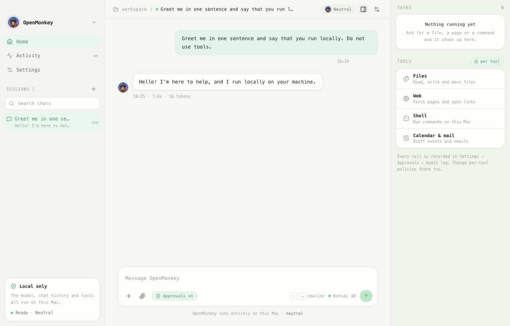
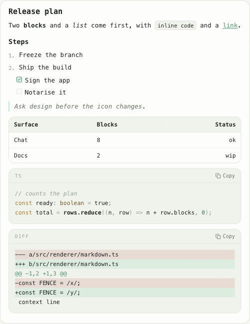
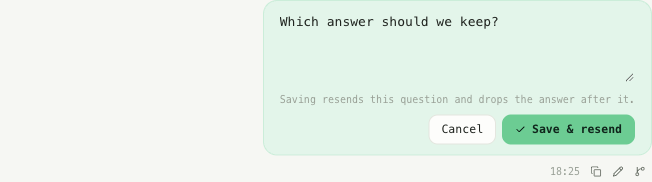
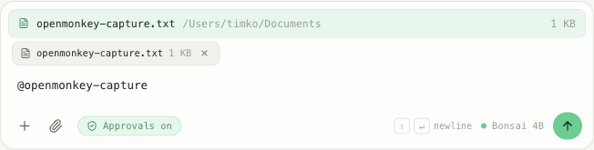
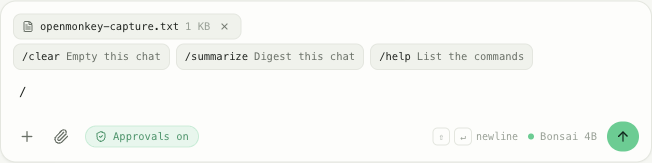
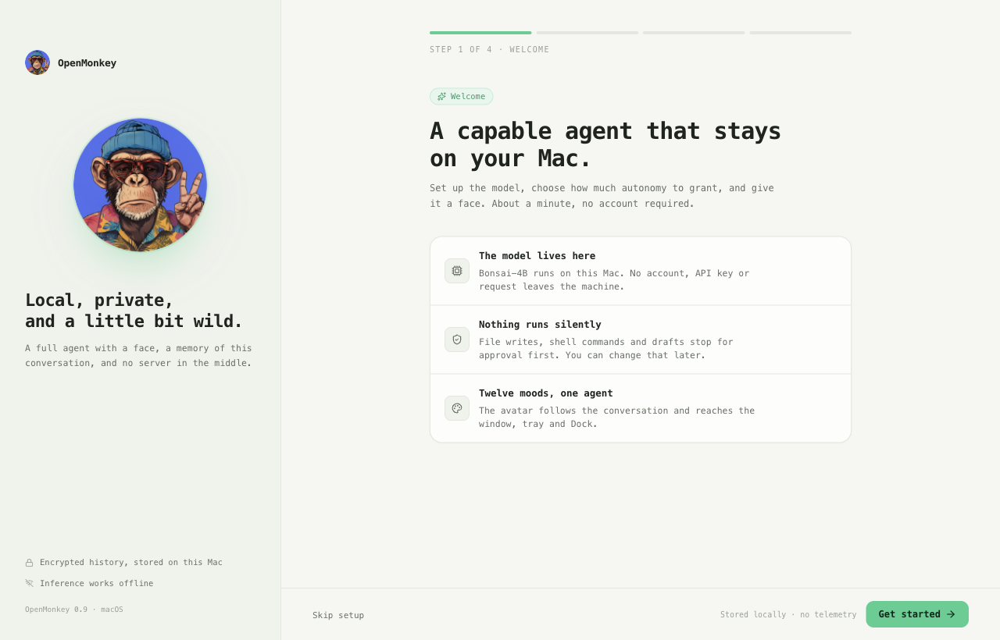
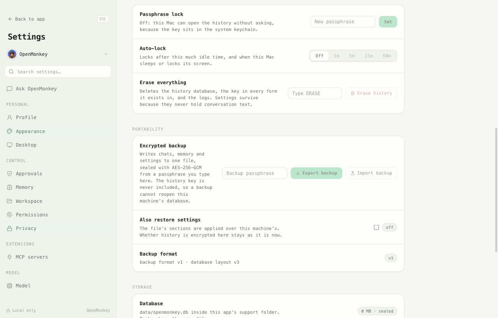
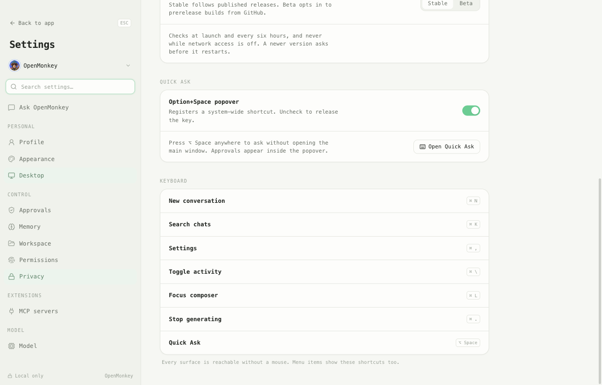
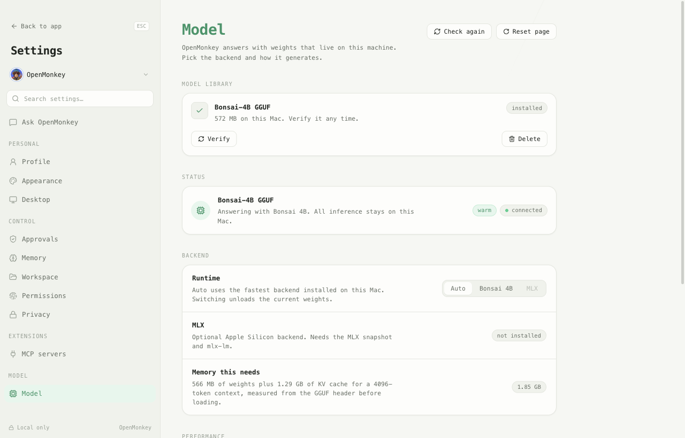

# OpenMonkey

<p align="center">
  
</p>

A local-only AI agent for your desktop. It runs a small language model on your own
machine, talks through a chat window, shows its working in a live task monitor, and
expresses how a conversation is going through 12 ape portrait moods that update the
window, the menu bar tray and the Dock icon at the same time.

Nothing leaves the computer by default. There is no account, no telemetry, no API key
and no network call except the ones you explicitly ask the agent to make.

The animation above is built from the same portraits the app uses:
`python3 scripts/make-logo-animation.py` regenerates it into `assets/brand/`.
A single-page product site lives in [`landing/`](landing/index.html) — open
`landing/index.html` directly or serve the folder with any static host.



An answer is markdown, not a wall of text: headings, task lists, tables, links,
highlighted code with a copy button and diffs render as themselves.



A reply can be rewritten, rerun or branched. Edit a question and the answer below
it goes with it; regenerate keeps the previous answer in a switcher; a branch
copies the chat up to any message into a chat of its own. Every reply shows how
long it took and how many tokens it used.




The composer carries the work. Drop a file on it, paste an image, or type `@` and
pick a file from the folders the app may read — up to eight files ride along with
one message. `/clear` empties the chat and `/summarize` asks the local model for a
digest, both without troubling the model with a request it would answer in prose.
Enter or Cmd+Enter sends, whichever the reader prefers.





| Onboarding | Settings → Privacy | Settings → Desktop | Settings → Model |
| --- | --- | --- | --- |
|  |  |  |  |

## Requirements

| | |
| --- | --- |
| OS | macOS 13+ (Apple Silicon and Intel); Windows 10+ for the GGUF backend |
| Runtime | Node.js 22.12 or newer (Electron 45's `engines` requirement) |
| Disk | 572,270,624 bytes for the pinned model (~546 MiB) |
| Memory | 455 MB for the shell before a model loads; ~2.0 GB total with Bonsai-4B loaded (measured 1.7 GB main + 0.3 GB helpers); plan for 4 GB |

## Get started

```bash
npm install          # also runs electron-rebuild for better-sqlite3
npm run download-models
npm run dev
```

`npm install` compiles `better-sqlite3` against Electron's ABI through the
`postinstall` hook. If you change Electron versions, re-run `npm run rebuild`.

`npm run download-models` fetches `prism-ml/Bonsai-4B-gguf` at a pinned revision into
`models/Bonsai-4B-gguf/Bonsai-4B.gguf`, verifies the pinned SHA-256, and deletes the
file on mismatch. Pass `--mlx` to additionally snapshot
`arcee-ai/Virtuoso-Lite-8bit-mlx` for the Apple Silicon backend (needs
`python3 -m pip install huggingface_hub mlx-lm`); without the flag it is skipped. See
[docs/MODELS.md](docs/MODELS.md) for the compatibility table.

The first launch loads the weights into memory, so the window shows a "Loading the
local model" card — with elapsed seconds — for a few seconds before the composer
becomes active.

## Scripts

| Command | Does |
| --- | --- |
| `npm run dev` | electron-vite dev server with hot reload |
| `npm run build` | Production bundles for main, preload and renderer |
| `npm run typecheck` | Checks the node, web and test TypeScript programs |
| `npm test` | Unit suites then integration suites (`node:test`) |
| `npm run test:e2e` | Builds and runs Playwright against the real Electron app |
| `npm run download-models` | Fetches model weights (`--mlx` for the MLX snapshot) |
| `npm run benchmark-model` | Prints the GGUF memory estimate and a measured tokens/s |
| `npm run rebuild` | Rebuilds `better-sqlite3` for the Electron ABI |
| `npm run package:mac` | `build` + electron-builder DMG/zip into `release/` |
| `npm run package:win` | `build` + electron-builder NSIS installer |
| `node scripts/capture-docs.mjs` | Refreshes the screenshots in `docs/screenshots/` |

### Verification

`npm test` runs 75 unit assertions and 54 integration assertions against a real SQLite
file under a throwaway profile: the task-fence parser, tool-argument validation, the
backup envelope, the mood map, benchmark arithmetic, encryption flipping with `VACUUM`,
retention, approval gating, path confinement (including a symlink escape), log
redaction/rotation, the attachment prompt, the composer's file search and the upgrade
of a history file written by an older build.
`npm run test:e2e` adds 29 Playwright tests on a throwaway profile: onboarding, the
chat surface with a button/field/image/landmark audit, Privacy rows and switches,
RU/EN, close-to-tray, the update channel, the vibrancy and spring timings, Quick Ask
history, the composer (send key, slash commands, file mentions, attachments), and the
model manager's memory estimate plus a real tokens-per-second run against the loaded
weights. Performance budgets are their own four tests (cold start under 2.5 s, no long
tasks during a synthetic 320-token stream, idle memory under 900 MB, Settings served as
a lazy chunk). CI runs the same suites on both Mac architectures and packages tag
builds on `v*` (signing and notarization run when the Apple secrets are present); see
`.github/workflows/ci.yml`.

## How it is laid out

```
src/main/       Electron host: window, tray, IPC handlers, sandboxed preload
src/agent/      OpenMonkey core: prompt loop, mood detection, tool dispatch
src/agent/tools FileSystemTools, WebBrowserTools, ShellTools, CalendarEmailTools
src/models/     ModelManager → BonsaiGGUF (node-llama-cpp) or MLXServer, plus the
                downloader, benchmark maths and GGUF memory estimate
src/ui/         LogoManager (mood → icons), mood-detector, task-emojis
src/renderer/   React UI: chat, settings, task monitor, styles
src/utils/      config (electron-store), storage (SQLite + AES-GCM), logger, types
assets/logos/   12 circular 512px mood portraits, sliced from the art sheet
scripts/        download-models.ts, crop-logos.py, capture-docs.mjs
docs/           privacy, model compatibility, support, screenshots
```

The renderer and the main process never import each other's runtime code. They
share `src/utils/types.ts`, and everything else crosses the bridge through the
`window.electron` API that `src/main/preload.ts` exposes on a context-isolated,
sandboxed preload. Every subscription the renderer registers returns an
unsubscribe function, so views do not leak listeners.

`node-llama-cpp` is ESM with top-level await, so the CommonJS main bundle loads it
lazily with a dynamic import rather than a static `require`.

## The 12 moods

The agent infers a mood from the conversation and from its own replies. One
`setCurrentMood` call propagates to the tray icon, the Dock icon, the chat avatar,
the accent ring and the settings grid, and the chosen mood is persisted so the next
launch starts where you left it. Use **Cycle mood** in the sidebar to override it
manually.

`happy`, `neutral`, `angry`, `shocked`, `silly`, `cool`, `love`, `tired`,
`thinking`, `excited`, `calm`, `smile`

## Privacy and approvals

- Chat history, tasks, audit rows and memory facts live in `data/openmonkey.db`
  (SQLite) inside the app's userData directory: `~/Library/Application Support/openmonkey`
  in development and `~/Library/Application Support/OpenMonkey` once packaged.
- Message bodies are sealed with AES-256-GCM. The key sits in the macOS Keychain
  through `safeStorage`, falling back to `data/secret.key` with mode `0600` when no
  keychain is available.
- A passphrase lock wraps the key with scrypt (N=2¹⁵) and deletes every copy the app
  could open on its own; **Auto-lock** closes the database after idle, sleep or screen
  lock. A forgotten passphrase means the history cannot be read.
- Turning **Encrypt stored data** off rewrites every row as plaintext and `VACUUM`s the
  file; turning it back on re-seals everything under a fresh key.
- **Auto-delete after** (7/30/90/365 days, default 30) prunes old rows on launch and
  every six hours while the app runs. With history off, nothing is written to disk.
- The filesystem tool refuses any path outside `Documents`, `Downloads`, `Desktop`
  and the app's own data directory, and it caps reads at 256 KB.
- The composer reads the same folders: at most eight files per message, 256 KB each.
  Key- and environment-looking files (`.env`, `*.pem`, `id_rsa`) are never offered to
  the model, not even by name.
- Tool actions need approval by default. Until **Run tool actions without asking**
  is switched on in Settings → Approvals, every call — file write, shell command, web
  fetch, calendar or email action — stops at a dialog showing the tool and its
  arguments, with **Deny** / **Allow once** / **Remember for this session**.
- The renderer cannot reach the network: packaged builds get a `default-src 'self'`
  CSP with `connect-src 'none'`, applied in `onHeadersReceived`. Model inference
  happens in the main process, and **Network access** is a hard switch for every
  request the app makes itself.
- Logs rotate at 2 MB, keep two older copies, and replace conversation text, prompts
  and responses with their lengths before writing.

The full description, including update checks and what this does not protect, is in
[docs/PRIVACY.md](docs/PRIVACY.md).

## Configuration

Defaults live in `src/utils/config.ts` and are stored by electron-store under
`openmonkey-config`. Edit through Settings; the file is a plain JSON document in
userData if you prefer to change it directly.

| Key | Default | |
| --- | --- | --- |
| `model.provider` | `bonsai` | `bonsai` or `mlx` (MLX is Apple Silicon only) |
| `model.temperature` | `0.7` | 0 – 1.5 |
| `model.maxTokens` | `2048` | |
| `agent.name` | `OpenMonkey` | |
| `agent.personality` | `helpful` | |
| `agent.autoExecuteTasks` | `false` | Skips the approval dialog |
| `privacy.saveHistory` | `true` | |
| `privacy.encryptData` | `true` | |
| `privacy.autoDeleteAfter` | `30` | Days |
| `privacy.autoLockMinutes` | `0` | Off; needs a passphrase lock |
| `privacy.networkAllowed` | `true` | Hard switch for app-initiated requests |
| `desktop.launchAtLogin` | `false` | Packaged builds only |
| `desktop.closeToTray` | platform default | Off on macOS, on elsewhere |
| `desktop.updateChannel` | `stable` | `stable` or `beta` |
| `ui.language` | `en` | `en` or `ru` |
| `ui.sendKey` | `enter` | `enter` or `cmd-enter` |
| `ui.currentMood` | `neutral` | |

## Troubleshooting

**"No local model loaded" on launch.** Run `npm run download-models` (or **Download**
in Settings → Model for an installed build). Settings → Model shows which backends it
found; the GGUF path is `models/Bonsai-4B-gguf/Bonsai-4B.gguf` in development and
inside userData in packaged builds.

**`better-sqlite3` threw `NODE_MODULE_VERSION` mismatch.** `npm run rebuild`.

**MLX backend unavailable.** The MLX snapshot plus `mlx-lm` are optional and only
work on Apple Silicon; the backend selector hides the option when either is missing.

**Gatekeeper blocked an unsigned build.** Right-click → Open, or
`xattr -d com.apple.quarantine /Applications/OpenMonkey.app`. Local builds are not
signed; the CI package job signs and notarizes tag builds once the Apple secrets are
configured.

**Updates do nothing.** The updater runs only in a packaged app with **Network
access** on. Installed builds check at launch and every six hours; the channel lives
in Settings → Desktop → Updates.

**Forgot the passphrase.** There is no recovery by design. **Erase everything** in
Settings → Privacy drops the database and the key; the history cannot be decrypted.

**Want to watch the agent's internals.** `OPENMONKEY_DEVTOOLS=1 npm run dev` opens
DevTools; the packaged build stays closed. `OPENMONKEY_VERBOSE=1` also prints each
log line to the console, not only to `logs/openmonkey.log`.

More answers and the security-report path are in [docs/SUPPORT.md](docs/SUPPORT.md).

## Release notes

[CHANGELOG.md](CHANGELOG.md) records what shipped in 0.9.0 and its known limitations.

## License

MIT — see [LICENSE](LICENSE).
